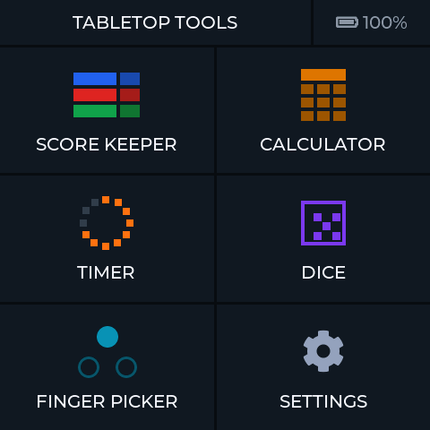
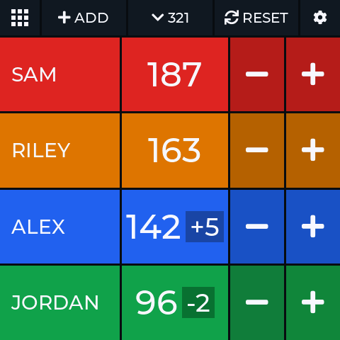
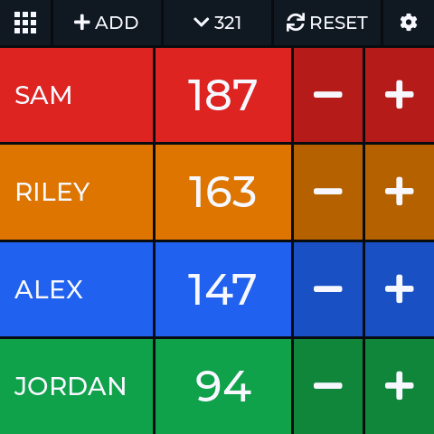
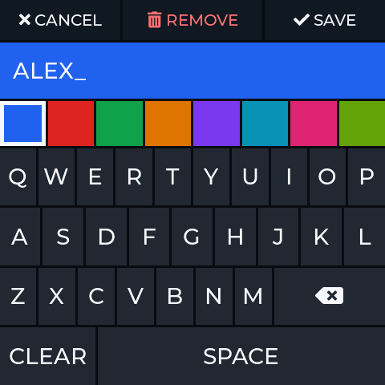
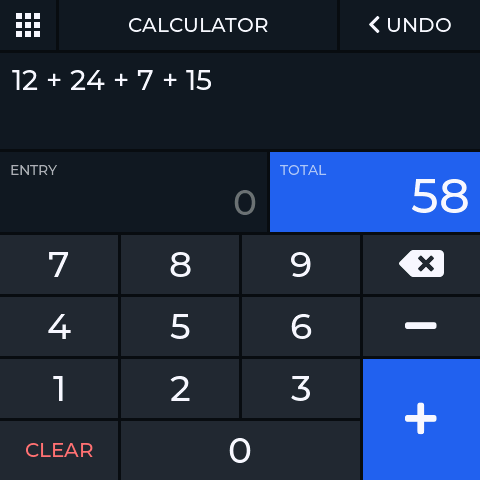
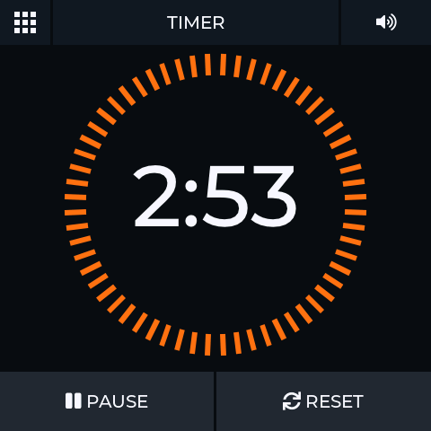
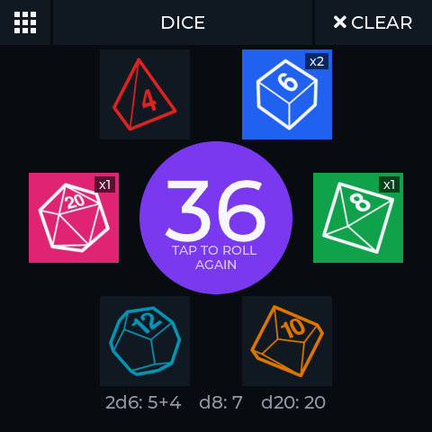
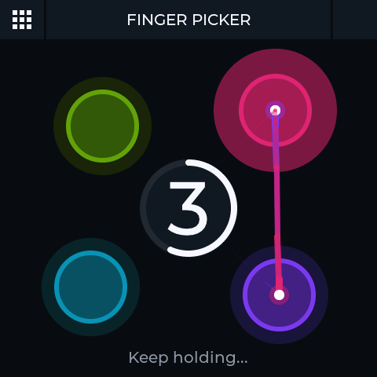
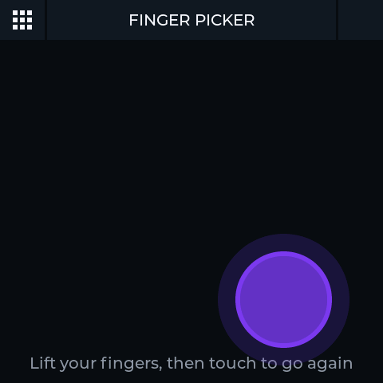
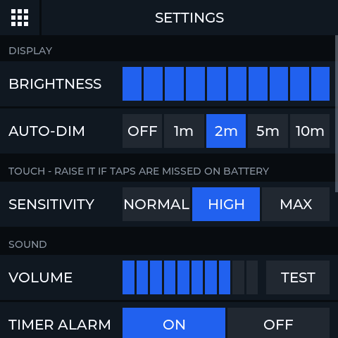

# Tabletop Tools

**A game-night companion on a 4-inch touchscreen.** Keep score, add up points, time turns, roll dice and pick who goes first, all on one small square screen that sits on the table. You don't need a phone or an internet connection.

  
  

Tabletop Tools is firmware for the Waveshare **ESP32-S3-Touch-LCD-4B**, a touchscreen board that costs about $34. Flash it once, and the board starts straight into a home screen with six tools. It saves players and scores as you go, so a game can run across several nights. Add a battery and it's cordless.

*All screenshots are captured from the device itself.*

---

## Features

### Score Keeper

  
  
  

- **1 to 8 players**, each with their own color. The rows resize to fill the screen.
- **Tap + or −** and the change waits beside the score as a chip, such as `142 +5`. When scoring pauses, every chip is added at once, the totals count up, and the rows slide into order.
- **Hold + or −** to count quickly. The step can be 1, 5, 10 or 25.
- **Sort** highest-first or lowest-first.
- **Tap a name** to rename a player or change their color. **ADD** brings in a new player.
- **RESET** sets everyone to a starting score, with a preview first.
- **Saved as you play.** Players, scores and options survive a power cut.

### Calculator

An adding machine for tallies, such as domino pips or end-of-round points.
- Type a number and tap **+** or **−**. The **TOTAL** counts up to the new sum.
- The **tape** keeps the whole sum, such as `12 + 24 + 7 + 15`, and you can scroll back through it.
- **UNDO** takes back the last number. Tapped right after **CLEAR**, it brings the whole tape back.

### Timer

- **Drag around the ring** to set up to 5 minutes, in 5-second steps.
- **Tap the time** for exact minutes and seconds, or presets from 30 seconds to 15 minutes.
- **START**, **PAUSE** and **RESET**. When time runs out, the ring flashes and the alarm beeps. The alarm can be muted.
- It keeps counting while you use other apps, and the screen won't switch off while it runs.

### Dice

- Choose any mix of **d4, d6, d8, d10, d12 and d20**. Tap a die to add one, and hold it to take one away.
- **ROLL** spins through numbers and lands on the total. Each die's result is listed underneath, for example `2d6: 5+4   d8: 7   d20: 20`.
- Tap the total to roll the same dice again.
- Rolls are fair. They use the chip's hardware random number generator, and every face is equally likely.

### Finger Picker

  
  

Who goes first? Everyone puts a finger on the screen.
- Each finger lights up in its own color, for **up to 5 players**.
- A 5-second countdown runs while streaks of light bounce between the fingers. If someone joins late, the countdown starts again.
- One finger is picked at random, and it stays lit after everyone lets go.

### Settings

- **Display:** brightness, and auto-dim after 1 to 10 minutes.
- **Touch:** sensitivity, set to **High** by default so taps register reliably on battery.
- **Sound:** volume with a test beep, the timer alarm, and optional tap clicks.
- **Battery:** charge level, charging status and voltages.
- **System:** version info, and **Reset all data**.

### Buttons and power

- **PWR, short press:** turns the screen off or back on.
- **PWR, hold 1.5 seconds:** saves everything and powers off. A short press turns it back on.
- **BOOT:** returns to the home screen from any app.
- The **battery level** is shown on the home screen. A warning appears at 15% and again at 5%.

---

## What you need

> **Affiliate links:** the Amazon links for the board and the battery are affiliate links. As an Amazon Associate I earn from qualifying purchases, at no extra cost to you. The Waveshare store link and the speaker search aren't affiliate links.

| Part | Needed? | Notes | Where to buy |
|---|---|---|---|
| **Waveshare ESP32-S3-Touch-LCD-4B** | Yes | 4-inch 480×480 touchscreen with an ESP32-S3, 16 MB flash, 8 MB PSRAM and a battery charger. About $34. | [Waveshare store](https://www.waveshare.com/esp32-s3-touch-lcd-4b.htm) · [Amazon](https://link.amazon/B01artEb4) (affiliate) |
| **USB-C cable** | Yes | Must carry data, not just charge. It's for flashing the firmware and charging. | Any |
| **3.7 V lithium battery** with a **PH2.0 2-pin** plug | Optional | Makes the board cordless; it charges over USB-C. If you buy a different one, choose one with built-in protection. | [Amazon](https://link.amazon/B066XOa4f) (affiliate) |
| **8 Ω 2 W speaker** with an **MX1.25 2-pin** plug | Optional | Needed for the timer alarm, the Finger Picker's ticks and chime, and tap clicks. Without one, everything else works silently. | [Amazon](https://www.amazon.com/s?k=8+ohm+2W+speaker+MX1.25+2+pin) |

> **Before you buy:** Waveshare's listing includes only the board, with no cable, battery or speaker. Its similar boards, such as the **ESP32-S3-Touch-LCD-4** and **ESP32-S3-Touch-LCD-4.3B**, are different hardware and aren't supported. Make sure the part number ends in **4B**. The price was checked in November 2026.

> **Battery safety:** the wiring of PH2.0 plugs differs between battery makers. Before connecting a battery, check its polarity against the board's markings, or against the pinout on [Waveshare's wiki](https://www.waveshare.com/wiki/ESP32-S3-Touch-LCD-4B). A reversed battery can damage the board.

---

## Flash the board

All you need is the **Chrome** or **Edge** browser on a computer. There's nothing to install.

1. **Download** [firmware/tabletop-tools.bin](firmware/tabletop-tools.bin).
2. **Plug the board into the computer** with a USB-C cable. Either USB-C port works.
3. **Open** [Espressif's web flasher](https://espressif.github.io/esptool-js/) and click **Connect**. Pick the board's port from the list.
4. **Change the Flash Address from `0x1000` to `0x0`.** The board won't start if this is wrong. Then choose the file you downloaded.
5. **Click Program**, and wait for it to finish. This takes about a minute.
6. **Unplug the cable and plug it back in.** The home screen appears.

**If Connect can't find the board, or Program fails:** unplug the cable, hold the **BOOT** button, plug the cable back in, then let go. Click **Connect** again. If a battery is fitted, unplug it first.

Flashing this way starts the board fresh. Saved players, scores and settings are cleared, and Score Keeper starts with four players at 0. Tap a name to make it yours.

> Building from source instead? See [docs/DEVELOPMENT.md](docs/DEVELOPMENT.md#build-and-flash). Flashing with `idf.py flash` keeps saved players, scores and settings.

**Tips**
- **Taps missed on battery?** Go to Settings > Touch > Sensitivity and choose **Max**. A board lying flat on battery isn't grounded, so the screen picks up fingers more weakly than when it's plugged in.
- **Don't hold BOOT** while the board powers up during normal use, because that puts it into flashing mode.

---

## For developers

- [docs/DEVELOPMENT.md](docs/DEVELOPMENT.md) covers how every feature behaves in detail, the build setup, and the on-device test checklist.
- `main/` holds the firmware: `apps/` (one folder per tool), `services/` (storage, power, sound, touch) and `ui/` (theme, navigation, shared components).
- `firmware/` holds the ready-to-flash image used above. [Rebuild it](docs/DEVELOPMENT.md#updating-the-browser-flash-file) after firmware changes.
- `tools/` holds the dice icon converter, a backup of the touch chip's factory settings, and the [screenshot capture](tools/screenshots/README.md) used for this page.

**Built with:** [ESP-IDF](https://github.com/espressif/esp-idf) v5.5.5 · [LVGL](https://lvgl.io) 9.5.0 · Waveshare board support package 2.0.0
